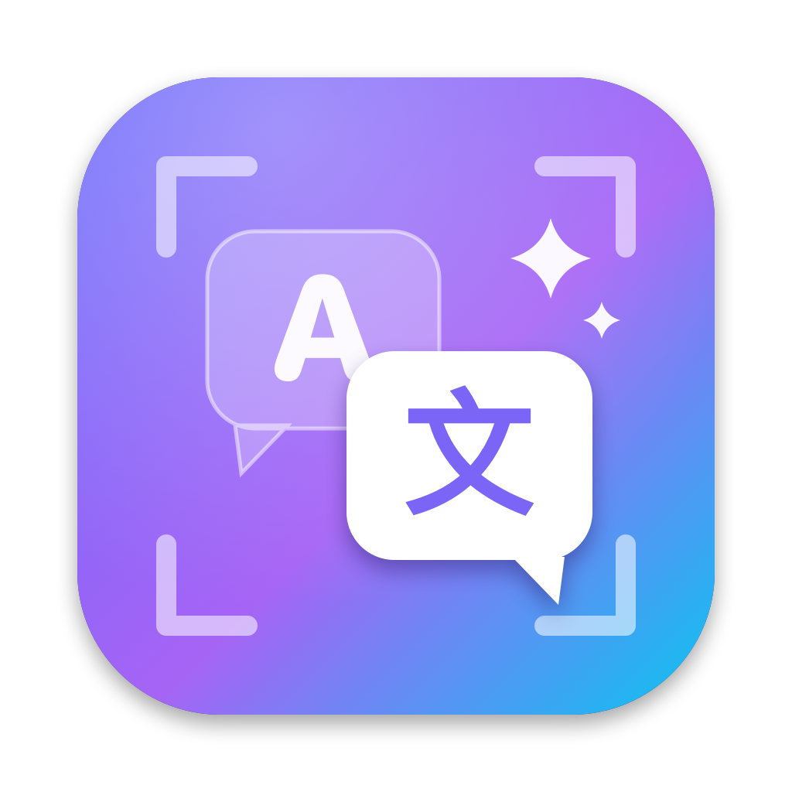

<p align="center"></p>

<h1 align="center">ScreenTranslator</h1>

<p align="center">macOS 狀態列翻譯小工具：按一下快捷鍵，辨識目前視窗中的文字，並把譯文直接疊在原文上。</p>

## 功能

- **一鍵翻譯目前視窗**：預設快捷鍵 `Fn + C`，再按一次或按 `Esc` 關閉
- **本機文字辨識**：使用 Apple Vision，支援英、日、韓、繁中、簡中
- **多種翻譯引擎**
  - 智慧優先：先用 AI 引擎，失敗時自動改用 Google
  - Google 免費翻譯（不需金鑰）
  - Google Gemini API
  - OpenAI API
  - Ollama 本機模型（離線、資料不外流）
- 啟動時先在背景準備文字辨識模型，按下快捷鍵後約 1 秒內顯示譯文

## 安裝

1. 到 [Releases](../../releases) 下載 `ScreenTranslator-x.y.z.dmg`
2. 開啟 DMG，把 **ScreenTranslator** 拖到「應用程式」資料夾
3. 第一次開啟時，在 App 上按右鍵 →「打開」（App 只有本機簽署，沒有經過 Apple 公證）
4. 到「系統設定 → 隱私權與安全性」開啟 **螢幕錄製** 與 **輔助使用** 權限

需要 macOS 14 以上，同時支援 Apple Silicon 與 Intel。

## 自行編譯

只需要 Xcode Command Line Tools：

```bash
./build.sh
```

產出的檔案在 `build/ScreenTranslator-<版本>.dmg`。

| 路徑 | 說明 |
| --- | --- |
| `Sources/main.swift` | App 原始碼 |
| `scripts/make_icon.swift` | 產生 App 圖示 |
| `assets/icon_1024.png` | 圖示原圖 |
| `build.sh` | 編譯、簽署並打包成 DMG |
